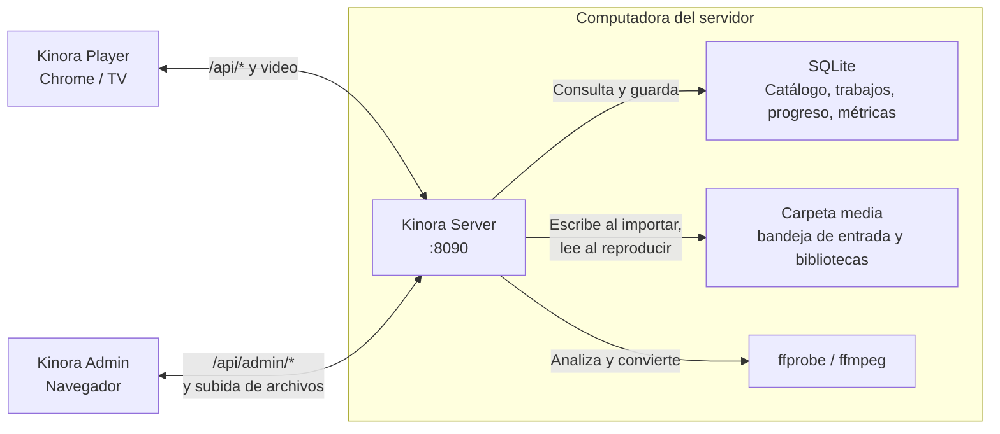

# Kinora: plan técnico

**Kinora reemplazará a Plex en la red local de la casa.** Tendrá tres componentes: Kinora Server, Kinora Admin y Kinora Player. El servidor se ejecutará en la computadora que guarda los videos y entregará las dos interfaces web desde un mismo puerto.

Este plan describe la arquitectura, las decisiones tomadas y el orden de implementación. Usa lenguaje controlado en español inspirado en STE100.

**El objetivo de la primera versión será completar este recorrido:** subir archivos desde el Admin, convertirlos al formato de Kinora, organizarlos como contenido, verlos desde Chrome y conservar el progreso después de reiniciar el servidor. La televisión se incorporará al final, cuando todo funcione sin ella.

## Principios

| Principio | Consecuencia |
|---|---|
| Solo red local | No hay cuentas ni login. El servidor escucha en `0.0.0.0` |
| La base de datos es la fuente de verdad | No hay escaneo de carpetas. El contenido entra solo por importación |
| Un único formato | Todo lo importado queda en el formato de Kinora. La reproducción siempre es directa |
| El contenido es distinto de sus archivos | Una película o un episodio existe aunque no tenga archivo. El progreso pertenece al contenido |
| Los originales no se tocan | Importar copia o convierte. Borrar el original es una acción explícita |
| Cada etapa se puede usar | Cada etapa termina con algo que se puede ver en Chrome |

## Componentes

| Componente | Función | Dónde se usa |
|---|---|---|
| **Kinora Server** | API, catálogo, importación, cola de conversión, entrega de video, métricas | Computadora del servidor |
| **Kinora Admin** | Bibliotecas, importación, cola, métricas, errores | Navegador de la computadora, con mouse y teclado |
| **Kinora Player** | Explorar, seguir viendo, reproducir | Chrome para validar; después, app de la TV |



**Las rutas estarán separadas por función:**

| Ruta | Contenido |
|---|---|
| `/` | Kinora Player |
| `/admin` | Kinora Admin |
| `/api/*` | API del Player: catálogo, progreso, video y subtítulos |
| `/api/admin/*` | API del Admin: bibliotecas, importación, trabajos y métricas |

Una ruta de API inexistente devolverá un error de API, no la página principal.

Hoy no hay login. La separación entre `/api/*` y `/api/admin/*` permitirá proteger el Admin más adelante con un solo middleware, por ejemplo con un PIN o limitando el acceso a una dirección IP. El Player solo lee y guarda progreso.

## Tecnología

**Kinora Server será un único binario de Rust.**

| Necesidad | Elección |
|---|---|
| HTTP | [Axum](https://docs.rs/axum) sobre [Tokio](https://docs.rs/tokio) |
| Entrega de video con HTTP Range | `tower_http::services::ServeFile` |
| Persistencia | SQLite con [SQLx](https://docs.rs/sqlx) y migraciones |
| Interfaces web dentro del binario | [rust-embed](https://docs.rs/rust-embed) |
| Métricas del sistema | [sysinfo](https://docs.rs/sysinfo) |
| Tipos compartidos con TypeScript | [ts-rs](https://docs.rs/ts-rs) |
| Análisis y conversión | `ffprobe` y `ffmpeg` instalados en el sistema |

**Kinora Admin y Kinora Player serán un único proyecto de Vite, React y TypeScript con dos puntos de entrada.** Compartirán el cliente de la API y los tipos generados desde Rust. Node.js solo se usará para desarrollar y compilar.

```
kinora/
├─ server/                    crate de Rust
│  ├─ migrations/             cambios del esquema de SQLite, en orden
│  └─ src/
│     ├─ main.rs              arranque
│     ├─ app.rs               estado compartido y rutas
│     ├─ config.rs, db.rs, error.rs, web.rs, health.rs
│     └─ <funcionalidad>/     una carpeta por funcionalidad (libraries/, debug/, ...)
│        ├─ mod.rs            tipos y rutas
│        ├─ handlers.rs       HTTP: recibe el pedido, valida, responde
│        └─ repo.rs           SQL
└─ web/
   ├─ index.html              entrada del Player (/)
   ├─ admin/index.html        entrada del Admin (/admin/)
   └─ src/
      ├─ shared/              cliente de la API; types/ se genera desde Rust
      ├─ admin/               Kinora Admin
      └─ player/              Kinora Player
```

Los tipos de `web/src/shared/types/` se regeneran con `cargo test`. No se editan a mano.

La distribución será el binario con las dos interfaces embebidas, más `ffmpeg` como dependencia del sistema.

## Configuración

**`config.toml` tiene solo lo que hace falta antes de abrir la base de datos.** Todo lo demás se configura desde el Admin y se guarda en la tabla `settings`.

| Dónde | Qué |
|---|---|
| `config.toml` | Interfaz de red, puerto, carpeta de datos (base de datos y backups), formato |
| Admin → Configuración | Carpeta media, elegida con un explorador de carpetas del servidor. Si ya hay bibliotecas, se elige entre "moverlas" (renombrado instantáneo, solo dentro del mismo disco; entre discos llega con la cola de la Etapa 4) o "ya las moví yo" (se verifica que estén) |
| Admin → Bibliotecas | Bibliotecas: subcarpetas de la carpeta media que Kinora crea y renombra |

```toml
bind = "0.0.0.0"
port = 8090
data_dir = "~/.kinora"              # base de datos y backups

[formato]
contenedor = "mp4"
video = "hevc"      # libx265, etiqueta hvc1; se copia si ya es HEVC
video_bits = 10     # decidido en la Etapa 0: mismo tamaño que 8 bits y menos banding
video_crf = 22
video_preset = "medium"
audio = "aac"       # se copia si ya es AAC; si no, mismos canales hasta 5.1
subtitulos = "externos"
```

El servidor mostrará su dirección y puerto al iniciar.

El perfil `[formato]` no tendrá pantalla de edición. Se define una vez y no se cambia.

## Formato de Kinora

**Todo archivo importado cumplirá este formato.** Así, Chrome y la TV reproducen directo y el servidor no transcodifica durante la reproducción.

| Elemento | Formato | Motivo |
|---|---|---|
| Contenedor | MP4 con `-movflags +faststart` | Reproducción directa en Chrome y Tizen; inicio rápido |
| Video | HEVC, etiqueta `hvc1`, resolución original, rango dinámico original (SDR o HDR10) | Ahorro de espacio. La TV y Chrome en Mac lo decodifican por hardware |
| Audio | AAC, mismos canales que el original, hasta 5.1 | Chrome no decodifica AC3/DTS de forma confiable |
| Subtítulos | Archivos externos junto al video | Chrome no muestra subtítulos incrustados en MP4 |

**La importación hace la operación mínima necesaria para cada archivo:**

| Situación del archivo | Operación | Costo |
|---|---|---|
| Ya cumple el formato | Copiar | Segundos |
| HEVC y AAC en otro contenedor (por ejemplo MKV) | Remuxar con `-c copy -tag:v hvc1` | Segundos |
| HEVC con audio incompatible | Copiar el video y convertir el audio | Minutos |
| Otro códec de video | Convertir el video con x265 | Horas por temporada |

### Rango dinámico

**Kinora nunca crea HDR.** Solo conserva el HDR que ya tiene el original y rechaza los casos en los que no puede conservarlo bien. Un archivo SDR se ve mejor que un HDR mal convertido.

La profundidad de color y el HDR son cosas distintas. HDR depende de la función de transferencia (PQ o HLG), de los colores primarios (BT.2020) y de sus metadatos. Codificar una fuente SDR de 8 bits en 10 bits no la convierte en HDR: el archivo sigue marcado como BT.709 y la TV lo muestra como SDR. Los 10 bits solo dan más precisión interna al codificador, lo que suele reducir el banding sin aumentar el tamaño. La Etapa 0 compara 8 y 10 bits con archivos reales y fija `video_bits`.

El análisis clasifica el video con ffprobe (`color_transfer`, `color_primaries`, `pix_fmt` y el registro de configuración de Dolby Vision en `side_data_list`):

| Original | Detección | Acción |
|---|---|---|
| SDR | `color_transfer` es `bt709` o no está definido | Copiar si es HEVC. Si no, convertir con `video_bits`. La salida se etiqueta como BT.709 de forma explícita |
| HDR10, HDR10+ o HLG en HEVC | `smpte2084` o `arib-std-b67` | Copiar el video sin recomprimir. Los metadatos HDR se conservan |
| HDR en otro códec | `smpte2084` o `arib-std-b67` en AV1, VP9 u otro | Rechazar con el motivo. No se convierte en la primera versión |
| Dolby Vision perfil 7 u 8 | Registro DOVI con `dv_profile` 7 u 8 | Copiar el video y quitar la capa Dolby Vision. Queda la capa base HDR10 |
| Dolby Vision perfil 5 | Registro DOVI con `dv_profile` 5 | Rechazar con el motivo. No tiene capa HDR10 y se ve con colores incorrectos en equipos sin Dolby Vision |

La UN43RU7100 no admite Dolby Vision. Admite HDR10, HDR10+ y HLG.

**Kinora no tendrá una opción para convertir HDR a SDR.** La TV admite HDR, y convertir a SDR pierde información de forma permanente.

**La validación de HDR se separa en tres niveles:**

| Qué se valida | Cómo | Requiere pantalla HDR |
|---|---|---|
| El archivo se reproduce, avanza y guarda progreso | Chrome con el HDR de macOS desactivado | No. La imagen puede verse más apagada |
| El archivo conserva el HDR | Verificación automática de la cola con ffprobe | No |
| El archivo se ve bien | Activar HDR en macOS de forma temporal, comprobar primero con un video HDR de referencia y después con el archivo | Sí |

### Subtítulos

Todos los subtítulos se guardan como `.vtt` al lado del video (`… - S01E01.spa.vtt`), que es lo que entienden los navegadores y la TV. Los ASS conservan además su original en `.ass`, para dibujar sus estilos más adelante. Llegan por dos caminos:

- **Al importar**, los de texto que vienen dentro del video (SRT, ASS, MP4) se extraen solos. Los de imagen (PGS de Blu-ray) se avisan en el análisis y por ahora no se usan.
- **Después**, desde Bibliotecas: cada archivo tiene "Agregar subtítulo", que acepta un `.srt`, `.ass`, `.ssa` o `.vtt`, con su idioma (sugerido por el nombre) y si es forzado. Los archivos que no están en UTF-8 se leen como Windows-1252, que es como suelen venir los `.srt` viejos en castellano. La bandeja de importación es solo para videos.

## Modelo de datos

**El contenido describe qué es. Los archivos describen cómo se reproduce.** Solo las películas y los episodios tienen archivos. Las series y las temporadas agrupan.

```
The Office (show)                     agrupa
├─ Temporada 1 (season)               agrupa
│  ├─ E01 "Pilot" (episode)           reproducible
│  │   └─ archivo .../S01E01.mp4
│  │        └─ subtítulo .../S01E01.spa.vtt
│  └─ E02 "Diversity Day" (episode)   sin archivo: válido
Interstellar (movie)                  reproducible
   ├─ archivo 1080p
   └─ archivo 4K
```

**Reglas del árbol:**

- Una película y una serie no tienen padre.
- Una temporada siempre pertenece a una serie. Toda serie tiene al menos una temporada. Los especiales son la temporada 0.
- Un episodio siempre pertenece a una temporada.
- Solo las películas y los episodios pueden tener archivos. El archivo es opcional.
- El Player oculta el nivel de temporada cuando la serie tiene una sola.

Las reglas se validan en la capa de dominio de Rust.

```sql
CREATE TABLE libraries (
  id INTEGER PRIMARY KEY,
  name TEXT NOT NULL UNIQUE,     -- "Películas", "Series", "Anime"
  dir TEXT NOT NULL UNIQUE       -- subcarpeta de media_dir; Kinora la crea y la renombra
);

CREATE TABLE contents (
  id INTEGER PRIMARY KEY,
  library_id INTEGER NOT NULL REFERENCES libraries(id),
  kind TEXT NOT NULL CHECK (kind IN ('movie', 'show', 'season', 'episode')),
  parent_id INTEGER REFERENCES contents(id),
  number INTEGER,                -- número de temporada o de episodio
  title TEXT NOT NULL,
  year INTEGER,
  overview TEXT,
  dir TEXT,                      -- solo movie/show, relativo a la carpeta de la biblioteca
  created_at INTEGER NOT NULL,
  UNIQUE (parent_id, number)
);

CREATE TABLE media_files (
  id INTEGER PRIMARY KEY,
  content_id INTEGER NOT NULL REFERENCES contents(id),
  rel_path TEXT NOT NULL UNIQUE, -- relativo a la carpeta de la biblioteca
  size INTEGER NOT NULL,
  duration REAL,
  video_codec TEXT,              -- ej. "hvc1.2.4.L120.90"
  width INTEGER,
  height INTEGER,
  probe_json TEXT,               -- salida completa de ffprobe
  source_path TEXT,              -- de dónde se importó
  imported_at INTEGER NOT NULL
);

CREATE TABLE subtitles (
  id INTEGER PRIMARY KEY,
  media_file_id INTEGER NOT NULL REFERENCES media_files(id),
  rel_path TEXT NOT NULL UNIQUE, -- siempre un .vtt (lo que entienden navegadores y TV)
  original_rel_path TEXT,        -- el .ass original, si lo había (estilos)
  language TEXT,                 -- ISO 639 tal como venía (spa, eng…)
  srclang TEXT,                  -- 2 letras para el navegador (es, en…)
  label TEXT NOT NULL,           -- "Español", "Inglés (forzados)"…
  is_default INTEGER NOT NULL DEFAULT 0,
  forced INTEGER NOT NULL DEFAULT 0
);

CREATE TABLE progress (
  content_id INTEGER PRIMARY KEY REFERENCES contents(id),
  position REAL NOT NULL,
  watched INTEGER NOT NULL DEFAULT 0,
  updated_at INTEGER NOT NULL
);

CREATE TABLE import_jobs (
  id INTEGER PRIMARY KEY,
  library_id INTEGER NOT NULL REFERENCES libraries(id),
  content_id INTEGER NOT NULL REFERENCES contents(id),
  source_name TEXT NOT NULL,     -- el nombre que tenía en la bandeja de entrada
  operation TEXT NOT NULL,       -- remux, audio, video
  action TEXT NOT NULL,          -- added, replaced, added_version
  rel_path TEXT NOT NULL,        -- destino final, relativo a la carpeta de la biblioteca
  state TEXT NOT NULL,           -- pending, running, done, failed, cancelled
  progress REAL NOT NULL DEFAULT 0,
  error TEXT,
  source_size INTEGER NOT NULL,
  result_size INTEGER,
  created_at INTEGER NOT NULL,
  started_at INTEGER,
  finished_at INTEGER
);

CREATE TABLE playback_daily (
  day TEXT NOT NULL,             -- AAAA-MM-DD, hora local
  content_id INTEGER NOT NULL REFERENCES contents(id),
  seconds REAL NOT NULL,
  PRIMARY KEY (day, content_id)
);

-- Historial: una fila por visualización. Copia título y biblioteca para que el historial
-- sobreviva a renombres y borrados. De acá salen las métricas por biblioteca, contenido,
-- equipo, día u hora.
CREATE TABLE playback_sessions (
  id INTEGER PRIMARY KEY,
  content_id INTEGER REFERENCES contents(id) ON DELETE SET NULL,
  library_id INTEGER REFERENCES libraries(id) ON DELETE SET NULL,
  title TEXT NOT NULL,
  library_name TEXT,
  client TEXT NOT NULL,
  started_at INTEGER NOT NULL,
  ended_at INTEGER NOT NULL,
  seconds_watched REAL NOT NULL DEFAULT 0,
  start_position REAL NOT NULL,
  end_position REAL NOT NULL,
  duration REAL,
  completed INTEGER NOT NULL DEFAULT 0
);

CREATE TABLE server_samples (
  ts INTEGER PRIMARY KEY,        -- un registro por minuto
  cpu_system REAL, cpu_kinora REAL, cpu_ffmpeg REAL,
  mem_system_used INTEGER, mem_system_total INTEGER, mem_kinora INTEGER
);
```

**Decisiones que sostienen el modelo:**

- **El progreso pertenece al contenido.** Si se reemplaza el archivo de un episodio, el progreso se conserva.
- **Las rutas son relativas.** Las bibliotecas guardan solo el nombre de su carpeta dentro de `media_dir`, y los archivos su ruta dentro de la biblioteca. Mover todo a otro disco exige cambiar solo `media_dir`. Renombrar una biblioteca renombra su carpeta sin tocar los registros de archivos.
- **La carpeta es una consecuencia del contenido, no su identidad.** El contenido se identifica por su `id`. La carpeta se calcula al importar a partir del título y el año. Corregir un título permite mover la carpeta sin perder relaciones.
- **El JSON de ffprobe se guarda completo.** Las columnas `duration`, `video_codec`, `width` y `height` se derivan de él para ordenar y filtrar. Otros datos se consultan con las funciones JSON de SQLite.

**Las ampliaciones previstas se agregan como tablas o columnas nuevas:**

| Ampliación | Cambio |
|---|---|
| Datos de TMDB | `external_ids(content_id, provider, external_id)` |
| Carátulas y fondos | `artwork(content_id, kind, rel_path)` |
| Colecciones ("Studio Ghibli") | `collections` y `collection_contents`, de muchos a muchos, fuera del árbol |
| Numeración absoluta de anime | Columna `absolute_number` en `contents` |
| Perfiles | Columna `profile_id` en `progress` y `playback_daily` |

## Estructura en disco

**Kinora organizará cada biblioteca con nombres compatibles con Plex.** Plex podrá leer la misma carpeta mientras se usan los dos en paralelo.

```
<media_dir>/<biblioteca>/
├─ Interstellar (2014)/
│  ├─ kinora.json
│  └─ Interstellar (2014).mp4
├─ Frieren (2023)/
│  ├─ kinora.json
│  ├─ Season 01/
│  │  ├─ Frieren (2023) - S01E01.mp4
│  │  ├─ Frieren (2023) - S01E01.spa.srt
│  │  └─ Frieren (2023) - S01E01.spa.ass
│  └─ Season 02/
├─ .kinora-tmp/       archivos en conversión
└─ .kinora-trash/     archivos reemplazados o eliminados

<media_dir>/.kinora-inbox/   bandeja de entrada: archivos subidos que esperan ser importados
```

`kinora.json` describe el contenido de su carpeta: tipo, título, año, temporadas, episodios, archivos y subtítulos. Es el respaldo en disco de la base de datos, que sigue siendo la fuente de verdad. Permite reconstruir el catálogo si se pierde la base. La reconstrucción es una acción manual, no un escaneo periódico.

- **Cuándo se escribe:** al importar, al agregar o quitar un subtítulo y al arrancar el servidor (así se ponen al día los contenidos viejos o con un formato anterior). Se escribe a un temporal y se renombra, para que nunca quede a medias.
- **Rutas relativas a la carpeta del contenido:** sobreviven a mover la carpeta media o renombrar la biblioteca.
- **No guarda** lo que se puede recalcular (ffprobe, tamaños) ni lo que es de quien mira (progreso, historial).
- **`kinora`** es la versión del formato, para que la reconstrucción sepa leer los viejos.

```json
{
  "kinora": 1,
  "kind": "show",
  "title": "Frieren",
  "year": 2023,
  "seasons": [{
    "number": 1,
    "title": "Temporada 1",
    "episodes": [{
      "number": 1,
      "title": "Episodio 1",
      "files": [{
        "path": "Season 01/Frieren (2023) - S01E01.mp4",
        "source": "[Erai-raws] Sousou no Frieren - 01.mkv",
        "imported_at": 1791835007,
        "subtitles": [{
          "path": "Season 01/Frieren (2023) - S01E01.spa.vtt",
          "original": "Season 01/Frieren (2023) - S01E01.spa.ass",
          "language": "spa", "label": "Español", "default": true, "forced": false
        }]
      }]
    }]
  }]
}
```

Las películas llevan `files` en lugar de `seasons`.

`.kinora-tmp/` está dentro de cada biblioteca, y la bandeja de entrada dentro de la carpeta media, para que mover un archivo a su lugar final sea un renombrado atómico e instantáneo en el mismo disco.

## Importación

**El contenido entra a Kinora solo mediante importación.**

1. **Subir archivos.** El usuario suelta videos o una carpeta entera en el Admin. Se suben a la bandeja de entrada. El navegador no expone las rutas de los archivos, así que subirlos es la única forma de que lleguen al servidor; funciona desde cualquier equipo de la red.
2. **Analizar.** El servidor ejecuta ffprobe sobre cada archivo y devuelve la operación necesaria, el tamaño estimado y los subtítulos encontrados.
3. **Elegir destino.**
   - Contenido nuevo: película o serie, con título, año y biblioteca.
   - Contenido existente: elegir la serie (o la película) y una temporada existente o nueva. Si el título que se deduce del nombre del archivo coincide con algo de la biblioteca, Kinora lo propone solo.
4. **Asignar episodios.** Una tabla editable asigna cada archivo a un número de episodio. Kinora la propone a partir del nombre (`S02E03`, `- 15`). El usuario la corrige si hace falta.
5. **Resolver conflictos.** Si un episodio ya tiene archivo, el usuario elige: omitir, reemplazar o agregar como otra versión (uno por uno o para todos). Sin elegir, el servidor rechaza el pedido sin crear nada.
   - Omitir: el archivo sigue en la bandeja.
   - Reemplazar: los archivos anteriores del episodio (todas sus versiones) y sus subtítulos van a `<biblioteca>/.kinora-trash/<fecha y hora>/`, con la misma ruta que tenían. Si mover el nuevo falla, vuelven a su lugar.
   - Otra versión: `… - S01E05 - v2.mp4`, al lado del anterior.
6. **Confirmar.** El servidor crea en una transacción los contenidos que faltan (serie, temporada, episodios) y un trabajo por archivo. Los episodios existen desde este momento, sin archivo.
7. **Procesar.** La cola ejecuta cada trabajo y asocia el archivo al contenido al terminar.

Antes de confirmar, el servidor comprueba que haya espacio libre suficiente para los archivos resultantes.

Al importar, el archivo se mueve de la bandeja a la biblioteca. Los archivos que no se importan se pueden descartar desde la bandeja.

## Cola de conversión

**La cola es el único proceso en segundo plano de Kinora.** Ejecuta un trabajo por vez, y solo cuando se la inicia: importar agrega los trabajos sin empezarlos, el botón "Iniciar cola" la pone en marcha y se detiene sola al vaciarse. "Pausar" deja terminar el trabajo en curso y no toma el siguiente. El estado (en marcha o detenida) se guarda en `settings` y sobrevive a un reinicio. Desde la Etapa 3 hace remux (y la conversión del audio a AAC); en la Etapa 4 suma la conversión del video.

Los archivos que ya cumplen el formato no pasan por la cola: se mueven en el momento. Los que necesitan remux salen de la bandeja al confirmar y esperan en `<biblioteca>/.kinora-tmp/job-<id>-source.<ext>`, así no se pueden importar dos veces. Qué reemplaza un trabajo (si se eligió "reemplazar") se decide al terminar, con los archivos que tenga el episodio en ese momento. Los subtítulos internos se extraen del original, porque el MP4 no lleva los del MKV.

Cada trabajo sigue estos pasos:

1. Escribir el resultado en `.kinora-tmp/`.
2. Verificar con ffprobe que el resultado cumple el formato, que su duración coincide con la del original (tolerancia del 1% o 2 segundos: lo que se busca son archivos cortados; los MKV a veces empiezan unos instantes después de 0 y lo cuentan en su duración; se comparan solo video y audio, porque los subtítulos pueden terminar después) y que conserva el rango dinámico: misma `color_transfer`, mismos `color_primaries` y, en HDR, los metadatos de masterización y de nivel de luz.
3. Mover el archivo a su ruta final con un renombrado atómico.
4. Registrar el archivo y sus subtítulos en la base de datos.
5. Reescribir `kinora.json`.

| Situación | Comportamiento |
|---|---|
| ffmpeg falla | Marcar el trabajo como fallido, guardar el error, borrar el temporal, devolver el original a la bandeja y seguir con el siguiente |
| La verificación falla | Igual que una falla de ffmpeg. El original queda intacto |
| El servidor se reinicia durante un trabajo | Borrar el temporal y volver el trabajo a pendiente |
| El usuario cancela | Detener ffmpeg (o sacarlo de la fila si no empezó), borrar el temporal, devolver el original a la bandeja y marcar el trabajo como cancelado |
| Falta espacio | Antes de confirmar: el remux necesita el tamaño de los originales libre, más 1 GB de margen |

El avance se obtiene de `ffmpeg -progress`. El Admin lo muestra con la velocidad (× tiempo real) y el tiempo estimado.

**Conversión del video (Etapa 4):** x265 con CRF 22, preset `medium`, 10 bits (`yuv420p10le`, perfil Main 10) y etiqueta `hvc1`. El espacio de color SDR se conserva tal como venía etiquetado; si no decía nada, BT.709 en HD y BT.601 en definición estándar. ffmpeg corre con prioridad baja (`nice -n 10`), para que reproducir algo siempre vaya primero. En un M3 Pro, 1080p convierte a unas 2,3 veces el tiempo real (un episodio de 24 minutos, unos 10) y el archivo queda en alrededor de un cuarto del original H.264.

**Al apagar el servidor** (Ctrl+C o SIGTERM) se corta el ffmpeg en curso; si no, seguiría solo y al volver a arrancar habría dos escribiendo el mismo archivo. Si Kinora muere sin poder avisar (`kill -9`), al arrancar busca un ffmpeg que siga escribiendo la salida de un trabajo interrumpido y lo corta antes de reintentarlo.

El original nunca se borra automáticamente. El Admin ofrecerá borrar los originales de una importación completa como acción explícita.

## Reproducción

**El Player reproduce siempre de forma directa.** El servidor entrega el archivo con `ServeFile`, que admite pedidos parciales (HTTP Range) para avanzar y retroceder.

1. El Player pide el detalle de un contenido. La respuesta incluye sus archivos, subtítulos y progreso.
2. El Player comprueba con `video.canPlayType()` que puede reproducir el códec del archivo. Si no puede, muestra el motivo.
3. El Player reproduce `/api/files/{id}/stream` desde la posición guardada.
4. Los subtítulos se piden como `<track>` a `/api/subtitles/{id}`: ya están en WebVTT desde que se agregaron.
5. El Player envía la posición y el estado (reproduciendo o en pausa) cada 10 segundos, al pausar y al salir.

El servidor guarda la última posición recibida. Retroceder reduce la posición guardada. Un contenido se marca como visto al superar el 90% de su duración.

No hay sesiones de reproducción. Se agregarán si en el futuro el servidor transcodifica en vivo y necesita administrar procesos por espectador.

## Métricas

**El Admin tendrá un panel de métricas.**

| Grupo | Métricas | Fuente |
|---|---|---|
| Servidor | CPU y memoria del sistema, de Kinora y de ffmpeg; uptime | `sysinfo`, una muestra por minuto en `server_samples`, 30 días |
| Servidor en vivo | Los mismos valores, actualizados cada 2 segundos | Memoria del proceso |
| Almacenamiento | Espacio libre por disco, tamaño por biblioteca | `sysinfo` y `media_files` |
| Reproducción | Minutos por día, semana y mes; lo más visto; viendo ahora | `playback_daily` y los avisos de progreso |
| Conversión | En la cola, espacio ahorrado, velocidad media respecto del tiempo real, listos y fallidos en 30 días; CPU y memoria de ffmpeg mientras corre | `import_jobs` (tarjeta "Conversión" en Estado) y `sysinfo` |

**Los minutos de reproducción se calculan así:** el servidor suma el tiempo real transcurrido entre dos avisos consecutivos en estado "reproduciendo", con un tope de 30 segundos por intervalo. Adelantar no suma minutos. Una pausa no suma minutos. Si la TV se apaga sin avisar, se pierden como máximo 30 segundos.

**"Viendo ahora"** lista los contenidos con un aviso en estado "reproduciendo" de los últimos 30 segundos.

## Kinora Player

**El Player se diseña para el control remoto desde la primera versión.**

- Pantalla de 1920×1080. Las apps de Tizen trabajan en esa resolución.
- Navegación solo con flechas, Enter y Atrás, con [Norigin Spatial Navigation](https://github.com/NoriginMedia/Norigin-Spatial-Navigation).
- Foco siempre visible. Nada depende del hover del mouse.
- En Chrome, Escape y Backspace funcionan como Atrás. En la TV, Atrás es la tecla 10009.
- La dirección del servidor es configurable. El Player no asume que está en el mismo origen que el servidor.

Pantallas:

| Pantalla | Función |
|---|---|
| Inicio | Seguir viendo, agregados recientemente, bibliotecas |
| Biblioteca | Grilla de carátulas y búsqueda |
| Detalle | Descripción, temporadas, episodios y botón de reproducción |
| Reproductor | `<video>` con controles propios para el control remoto y subtítulos |

Si falta una carátula, el Player muestra una presentación alternativa con el título.

## Kinora Admin

| Pantalla | Función |
|---|---|
| Panel | Métricas, viendo ahora, estado de la cola |
| Bibliotecas | Crear, editar y eliminar bibliotecas |
| Importar | Subir archivos a la bandeja, analizar, asignar destino y confirmar |
| Configuración | Carpeta media, con un explorador de carpetas del servidor |
| Cola | Trabajos en curso, pendientes y fallidos; cancelar y reintentar |
| Contenido | Explorar el catálogo, corregir títulos, años y números |
| Mantenimiento | Verificar integridad, reconstruir desde disco, backup |

## API

**La API usa JSON e identificadores enteros.** Los tipos se generan desde Rust con ts-rs.

**Player (`/api`):**

| Operación | Ruta |
|---|---|
| Consultar bibliotecas | `GET /api/libraries` |
| Buscar contenidos | `GET /api/contents?library_id=&kind=&q=` |
| Consultar un contenido con hijos, archivos y progreso | `GET /api/contents/{id}` |
| Seguir viendo | `GET /api/continue-watching` |
| Agregados recientemente (películas y series con algo nuevo; lo importado dentro de 24 h cuenta como una tanda) | `GET /api/recent` |
| Reproducir un archivo | `GET /api/files/{id}/stream` |
| Obtener un subtítulo | `GET /api/subtitles/{id}` |
| Informar progreso | `PUT /api/contents/{id}/progress` |

**Admin (`/api/admin`):**

| Operación | Ruta |
|---|---|
| Administrar bibliotecas | `GET`, `POST`, `PATCH`, `DELETE /api/admin/libraries[/{id}]` |
| Carpeta media | `GET`, `PUT /api/admin/settings/media-dir` |
| Explorar y crear carpetas del servidor | `GET /api/admin/folders?path=`, `POST /api/admin/folders` |
| Bandeja de entrada: listar, subir, descartar | `GET /api/admin/uploads`, `POST /api/admin/uploads?name=`, `DELETE /api/admin/uploads/{name}` |
| Analizar archivos | `POST /api/admin/imports/analyze` |
| Confirmar una importación | `POST /api/admin/imports` |
| Agregar un subtítulo a un archivo (el cuerpo es el archivo) | `POST /api/admin/files/{id}/subtitles?name=&language=&forced=` |
| Quitar un subtítulo (y sus archivos) | `DELETE /api/admin/subtitles/{id}` |
| Consultar la cola (si está en marcha; pendientes, en curso y los últimos 20 terminados) | `GET /api/admin/jobs` |
| Iniciar o pausar la cola | `POST /api/admin/jobs/start`, `POST /api/admin/jobs/pause` |
| Cancelar un trabajo (el original vuelve a la bandeja; reintentar es volver a importarlo) | `POST /api/admin/jobs/{id}/cancel` |
| Editar un contenido | `PATCH /api/admin/contents/{id}` |
| Eliminar un contenido (a la papelera) | `DELETE /api/admin/contents/{id}` |
| Métricas | `GET /api/admin/metrics/{server,storage,playback,imports}` |
| Verificar integridad | `POST /api/admin/maintenance/integrity-check` |

## Mantenimiento

| Acción | Cuándo | Resultado |
|---|---|---|
| Backup de SQLite con `VACUUM INTO` | Una vez por día y a pedido | Copia en `data_dir/backups`, se conservan 14 |
| Verificar integridad | A pedido | Lista de archivos registrados que no existen en el disco |
| Reconstruir desde disco | A pedido, ante una pérdida de la base | Catálogo recreado a partir de los `kinora.json` |
| Vaciar papelera | A pedido | Borra `.kinora-trash/` previa confirmación |

## Etapas

**Cada etapa deberá cumplir su criterio antes de cerrar el trabajo.** Todas se validan en Chrome, salvo la última.

| Etapa | Trabajo | Criterio de finalización |
|---|---|---|
| 0. Prueba de formato | Convertir el mismo episodio SDR en 8 y 10 bits con el mismo CRF; remuxar un original HDR10 en HEVC | Los archivos se reproducen en Chrome servidos con `python3 -m http.server`. Queda fijado `video_bits` según tamaño y banding en escenas oscuras y cielos |
| 1. Base | Servidor, configuración, SQLite, bibliotecas en el Admin, importar **solo copiando** archivos ya óptimos como contenido nuevo, Player con grilla y reproducción | Importar una película, reiniciar el servidor y reproducirla desde otro equipo de la red |
| 2. Ver | Progreso, seguir viendo, navegación con flechas, minutos de reproducción | Usar el Player sin mouse, pausar, reiniciar el servidor y reanudar |
| 3. Importación completa | Análisis, remux, extracción de subtítulos, contenido existente, tabla de episodios, conflictos, `kinora.json` | Importar la temporada 2 de una serie existente desde MKV en HEVC |
| 4. Conversión y métricas | Cola con x265 y AAC, verificación, cancelación, panel de métricas | Convertir una temporada en H.264, reiniciar a mitad de camino y completarla |
| 5. Instalación | Servicio del sistema, backup diario, integridad, reconstrucción, papelera | El servidor arranca solo con la computadora; borrar la base y reconstruirla |
| 6. TV | Empaquetar el Player para Tizen | Ver un episodio en la UN43RU7100 y reanudarlo en Chrome |

## Fuera del alcance inicial

- Transcodificación en vivo y streaming adaptativo (HLS).
- Selección de pista de audio en el Player. Chrome no la permite en un `<video>` común; requiere HLS.
- Datos y carátulas de proveedores externos (TMDB).
- Perfiles de usuario y login.
- DLNA.
- Importar el estado visto/no visto desde la base de datos de Plex.

## Decisiones abiertas

| Tema | Cuándo decidir |
|---|---|
| Subtítulos ASS en la TV: dibujarlos con [JASSUB](https://github.com/ThaUnknown/jassub) o quemarlos en la imagen al convertir | Etapa 6, según el rendimiento de la TV |
| Confirmar HEVC 10 bits en la UN43RU7100 | Etapa 6. Soporta HDR10 y HDR10+, por lo que es muy probable |
| App de Tizen: empaquetar los archivos del Player o abrir la URL del servidor | Etapa 6 |
| Varias versiones de un episodio: hoy el Player reproduce la primera. Elegir cuál (o la mejor para el dispositivo) | Cuando haya un caso real |
| Archivos con dos episodios (`S01E01-E02`) | Cuando aparezca el primer caso. Por ahora se tratan como un solo episodio |
| Proteger el Admin con PIN o por dirección IP | Cuando haga falta |
